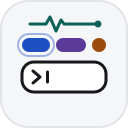

# claude-mods

Claude Code mods by [tinesoft](https://github.com/tinesoft), published as one plugin marketplace, `tinesoft-mods`. Each mod is an Nx project under `mods/`.

## Install

Install a mod from the `main` branch, which holds released code only. Without `@main` you track `develop`, which is unreleased.

```sh
claude plugin install <mod-name> --marketplace tinesoft/claude-mods@main
```

> `<mod-name>` = Name of the Mod to install (see below)

Mods need Claude Code 2.1.287 or later. CI tests against 2.1.302.

## Mods

|                                                                                                                                                                                                                                                                      | Mod                                         | What it does                                                                                                                                                                                                                              |
| -------------------------------------------------------------------------------------------------------------------------------------------------------------------------------------------------------------------------------------------------------------------- | ------------------------------------------- | ----------------------------------------------------------------------------------------------------------------------------------------------------------------------------------------------------------------------------------------- |
| <picture><source media="(prefers-color-scheme: dark)" srcset="assets/images/session-activity-logo-dark.svg"> </picture> | [`session-activity`](mods/session-activity) | A live row of chips above the prompt naming each skill, subagent, MCP server, permission call, hook and rule file that activated, with a card explaining each and a full `/session-activity` pane. Blocked and denied actions come first. |

## Contributing

See [CONTRIBUTING.md](CONTRIBUTING.md).

## License

[MIT](LICENSE)
